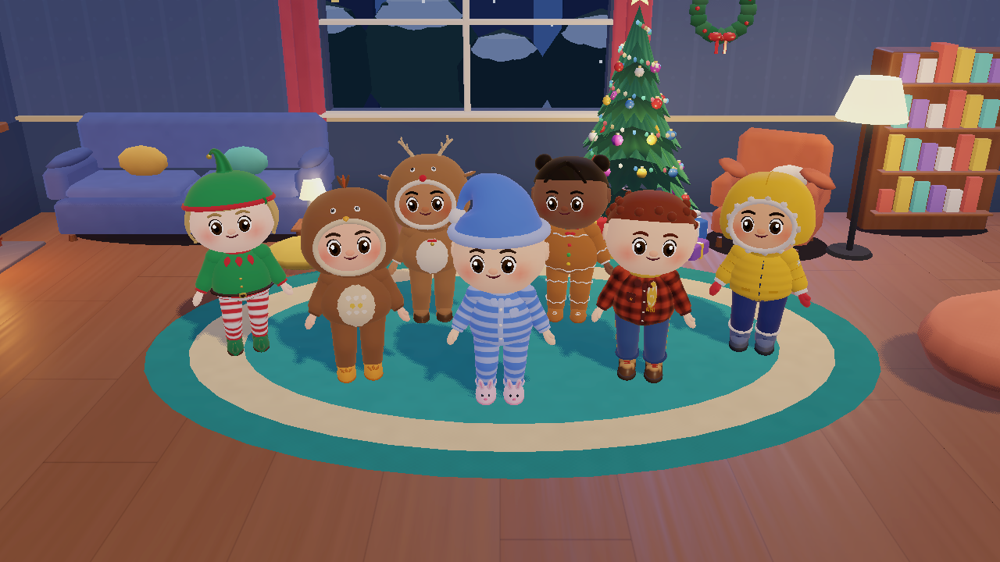

# 2.2: Season 1 · Winter Break (final pass before the App Store)

What changed in 2.2, how it was checked, and what still needs the owner.
Screenshots are desktop renders (Mobile renderer on llvmpipe under Xvfb, at
iPhone point sizes and safe areas), not device captures.

## 1. The holiday dorm (`game/src/view/holiday_decor.gd`)

The dorm common room behind Home, the Locker, the Shop, the Season Pass and
the party room is dressed for Season 1:

- a decorated tree in the back-right corner, in front of the window's right
  curtain: five tiers of zig-zag branches with drooping tips and a dark
  underside (the home camera sits below the upper tiers), a red tree skirt,
  41 glossy baubles, 104 fairy lights spiralling up it and a gold star;
- wrapped presents under it (seven boxes, ribbons both ways and bows);
- a wreath with berries and a bow where the yellow poster hung, a garland
  swagged along the window head with bows at its pins;
- twinkling multicolour string lights along the back wall (either side of
  the window, low enough for the home framing, and a higher run for the
  party framing) and the left wall;
- snow on the rooftops, trees and lawn outside the window, and snow falling
  past it (150 CPU particles, seen only through the opening).

Cost: the solid pieces join the room's one merged mesh (dorm shader); the
bulbs and star are one more mesh (`festive_lights.gdshader`, unshaded,
each bulb breathing at its own phase carried in its UV); one small omni
light in the tree plus two additive light pools. Reduced Motion: the bulbs
and tree light hold steady and no snow falls. The armchair moved a step
right (`DormStage.ARMCHAIR`) and the tree and presents are a walk-around
obstacle (`HubRoom.CIRCLES`). After the season set `HolidayDecor.ENABLED`
to false: the year-round poster and string lights come back.

| | |
|---|---|
| Home, before (2.1) | `media/p14_home_before.jpg` |
| Home, 2.2 (iPhone 14, 844×390 pt) | `media/p14_home.jpg` |
| Home, 2.2 (iPhone SE, 667×375 pt) | `media/se_home.jpg` |
| Party room, 4 players | `media/p14_lobby_4p.jpg` |
| Season Pass (test service adapter, Premium owned) | `media/p14_season_pass.jpg` |

## 2. Season 1 · Winter Break

- The season's name is "Winter Break" (`catalogue.json` → `seasons.s1.name`,
  the Premium item's name and blurb; the service copy regenerated with
  `service/tools/sync_catalogue.mjs`). Tiers, XP, rewards, item ids and
  claim keys are unchanged; the service tests pass (93).
- **Home** has a Season card (`SeasonCard`; since the second pass it sits
  in the party column of the home lobby, section 9): the
  snowflake, "SEASON 1 · WINTER BREAK", your tier, a bar of Season XP to
  the next tier, and "N to claim" or "Premium"; tap opens the Season Pass.
  With no game service in the build it says "Play online rounds" instead
  of numbers that can't move. It fits the iPhone SE's right column.
- **Season Pass:** the snowflake beside the season name; Premium reward
  cells are a clearly gold lane (warmer card, a gold rim on top).

## 3. The Night Watch starts at GO

`runner_head_start_s` is 0 (it was 6): the Night Watch leaves the Grounds
Shed at GO, together with the runners. The guided tutorial keeps its 30 s
hold (`patrol_release_extra_s`). The HUD's head-start lines only show while
a hold is running, so they no longer appear in ordinary rounds.

Seeded full bot rounds on Moonbrook College (`game/tools/p9_balance.gd`
with `BAL_MAP=classic`, 16 seeds per team size, the same seeds, halls and
waters for both; data in `data/`, tables in `data/balance_summary.md`):

| Night Watch | 6 s head start: runner wins | Together: runner wins | 1st capture |
|---|---|---|---|
| 1 | 16/16 | 16/16 | 65 s → 62 s |
| 2 (default) | 14/16 | 14/16 | 46 s → 40 s |
| 3 | 7/16 | 6/16 | 45 s → 42 s |

The outcome doesn't move (well inside the intervals); the first catch
comes a few seconds sooner. These are bots, not people: the default
(2 Night Watch) favours runners in bot play as it did in 1.9–2.1; re-check
with people on phones before tuning speeds.

## 4. Lakeside Campus: Coming soon

See `docs/maps/README.md` (top). The chooser keeps its card with the
preview and outline, a lock, a COMING SOON ribbon and tag; a tap says
"Lakeside Campus is coming soon. Stay tuned!" and keeps Moonbrook College
selected (`media/p14_map_coming_soon.jpg`). Parties, practice and every
saved choice play Moonbrook College.

## 5. Network

Protocol 11: no message changes, but the round's rules (release at GO),
the playable map and the party room's obstacles differ, so 2.1 and 2.2
refuse each other at join ("Update the game to join."). A four-process
UDP soak (host + 3 clients, 60 ms ± 10 ms, 3 % loss, two rounds) is in
`data/` when it completed.

## 6. Sweep notes

- CI's full suite caught one real layout bug: with Moonbrook College as
  the map, the party room's settings row ("Moonbrook College · 3 rounds ·
  …") was a point wider than the safe area on iPhone SE and iPad, pushing
  the roster and Start past it. The chip now uses the short name
  ("Moonbrook"). Full suite after the fixes: 585 tests, 359,610 checks,
  0 failures (local and CI).

- Rendered desktop runs log "Too many instances using shader instance
  variables… Maximum items supported by this hardware is: 4096". That cap
  is llvmpipe's 64 KB uniform buffer; Godot 4.7's Metal driver reports the
  device's maximum buffer length for the same limit, so an iPhone gets the
  project's 65,536 slots. Not a device glitch.
- A route test can rewrite `config/route_bot_times.json` (Lakeside timings)
  when its measured times drift; the file was restored, not changed.

## 7. Build lane: the Game Center/StoreKit plugin

The first 2.2 CI run stopped at "Fetch pinned plugins": upstream
GodotApplePlugins deleted its `build-<sha>` releases and tags after 2.1, so
the pinned asset answers 404 and no iOS build could be exported. The pinned
commit (`bfade13`, 2026-09-02) still exists, so `tools/fetch_deps.sh` now
builds exactly that commit from source on macOS with upstream's own release
recipe (two `make split-build` passes, `make split-dist`, unsigned),
verified by commit hash. CI caches the result by commit. Same plugin
version as 1.6–2.1; nothing in the game's use of it changed.

## 8. What 2.2 still needs from the owner

Purchases, Coins, Season XP and rewards, challenges and Friends status run
through the game service, which still isn't deployed, and the eight App
Store products and the Paid Apps Agreement don't exist yet. Until then the
build says so honestly and nothing can be bought. The order is in
`docs/OWNER_SETUP_GUIDE.md` (A agreements, B products, C service, D the
configured build, E sandbox test, F version page, G submit).

---

# Second pass: the lobby is home, Quick Match, chat, Rankings

Asked for after the first 2.2 build: typed party chat with bad words
bleeped, clean names, loading-screen tips, the stuck-at-GO glitch, a
shinier UI, 30-day leaderboards with run stats and a Season Champion
poster, and one home where you are always in your lobby with a playlist
picker instead of a "Play with Friends" button.

## 9. Home is your party lobby

| | |
|---|---|
| Home (a party of one, Quick Match selected) | `media/v22_home.jpg` |
| The playlist picker | `media/v22_playlists.jpg` |

- Opening the app puts you in your own party lobby in the holiday dorm
  (`App.goto_title` starts a party of one on `SoloTransport`): walk around,
  emote, change your look, Shop and Season Pass, all without a separate
  "online lobby". Friends (online friends, invites, **Add friends** =
  Game Center's friend-request sheet, "Join with a code"), Share and the
  party list are always there.
- Inviting a friend or sharing the party opens it on Game Center in place
  (`App.open_party`): the same room, settings and look; friends land next
  to you.
- One **PLAY** button and a **playlist** card (tap Change):
  **Quick Match** (random players online, bots fill the empty seats),
  **Party vs Bots** (your map and rounds) and **Practice** (offline, pick
  your role). With friends in the party, PLAY starts the party's round.
- **Quick Match** (`Social.quick_match_start`): Game Center automatch in a
  per-protocol player group; every device elects the lowest player id as
  host; the round starts by itself 8 s after the match forms, bots in
  empty seats; nobody in 25 s (or Game Center unavailable) and it starts
  with bots. After the round everyone goes back to their own lobby.
- **Rankings** (gold, top right) and Settings sit in the top bar.

## 10. Party chat, bleeped

| | |
|---|---|
| A bubble over the speaker's head | `media/v22_chat_bubble.jpg` |
| The chat drawer | `media/v22_chat_drawer.jpg` |

Typed chat works in any party (`ChatRules.bleep`): profanity, sexual words
and slurs become `#%&*` whatever the disguise (l33t, s-p-a-c-e-d,
stretched, doubled, split across words); threats, links, handles, phone
numbers and spam are refused outright. The sender, the host and every
receiver run the same filter (`SocialProto.Kind.MOD_TEXT`), so a modified
client can't push words past it. Report message / Report player / Block
stay on every message (Guideline 1.2), with "Report by email" when the
game service isn't reachable (needs `support_email` in `config/links.cfg`).
Names: typed names go through the full name policy (`NameRules`, reserved
names included); a rejected name falls back to a generated one.

## 11. Round start: no more frozen thumb

The fading loading screen's layout containers (and the role card) passed
touches up their own branch, so a thumb already on the stick was captured
and the runner didn't move at GO. Now the closing screen ignores input
(`UIKit.ignore_input_tree`), the touch surface adopts a finger that is
already down in the stick zone (`TouchSurface._input`), and the role card
is a compact banner under the top bar that waits for the loading screen to
go. Measured with `src/dev/start_probe.gd` (a held thumb from before GO):
old build never moved; 2.2 moves 46 ms after GO.

| | |
|---|---|
| Loading with a rotating tip | `media/v22_loading_tip.jpg` |
| The first frames of the round | `media/v22_round_start.jpg` |

Tips (`LoadingTips`) change every 5.5 s: role strategy, controller and
keyboard controls (for the device in use) and general play.

## 12. Rankings, run stats and the Season Champion

| | |
|---|---|
| Rankings (development sample rows) | `media/v22_rankings.jpg` |
| After a round: your run, best and Season Points | `media/v22_results_run.jpg` |
| The Season Champion poster (on launch, at most every 20 h) | `media/v22_champion_poster.jpg` |
| Official Rules (Guideline 5.3) | `media/v22_rules.jpg` |

- Two Game Center leaderboards, **created in App Store Connect** (workflow
  `iap=gc-create`, run #201): `ut.season_points` (best total, " pts") and
  `ut.fastest_run` (centiseconds, lowest first), recurring every 30 days
  (`PT720H`, Game Center's longest) from **2026-12-01**, Season 1 · Winter
  Break. App Store Connect refuses a recurring board that starts in the
  past, so the November preseason has no boards: its rounds count toward
  your own stats only, and Rankings says when the boards open.
- Season Points (`Rankings.round_points`): 10 played, 15 team win, 5 per
  splash (max 3), 10 home, 5 first home, 10 per distinct tag (max 3); at
  most 70 a round and 40 counted rounds a day; only online rounds with at
  least one other real player count. No divisions, no hidden rating, no
  gameplay rewards.
- The results card shows your run time, a NEW PERSONAL BEST chip, Season
  Points with the breakdown, or why the round didn't count.
- The Season Champion: #1 in Season Points designs (concept + name) a
  tier 100 skin of a following Season Pass. The poster pops up on launch
  at most every 20 h (never during the tutorial), X to close, and sits
  small on Rankings. Rules in the game and in `CONTEST_RULES.md`.
  (The results capture uses a practice fixture marked as an online round
  to show the points; a real practice round says it doesn't count.)

## 13. Candy UI

Solid buttons got a darker 3D base, a gloss band and a label shadow, and
sink when pressed; gold and teal are punchier (`UIKit.Face.shine`). All
screens use it, so every button changed together.

## 14. Checks for the second pass

- Full headless suite: see the commit message of the final 2.2 commit.
- New tests: `test_rankings` (points, caps, 30-day seasons, preseason,
  Guideline 5.3 statements), `test_chat` (bleeping in every disguise,
  device chat end to end), `test_loading::test_loading_tips_rotate`,
  `test_trust` (typed names), `test_pause_input` (stale fingers).
- Not verified on a device: Quick Match between two phones, Game Center
  leaderboards (they open on 1 Dec), the friend-request sheet. These need
  TestFlight testers; see `docs/testflight/what_to_test.txt`.

---

# Third pass: a professional UI, in-game invites, a clean launch

Asked for after build 12: the UI still felt crowded and boxed in; the
champion poster's edges glitched when the app opened; invites shouldn't need
Apple's sheet ("in the game but tied to Game Center").

## 15. Launch: home first, then the poster

`--launch-probe` (src/dev/launch_probe.gd) saves every frame of the first
seconds after launch. Build 12 opened the champion poster under the fading
Idlery logo, before home was ever seen, and the poster painted a square
gradient over its rounded frame, with rays and confetti spilling past the
corners. Now:
- home waits for the launch curtain to go (`BootCurtain.live`) and 0.9 s
  more before the poster (`ChampionPromo.show_when_settled`);
- the poster's gradient, rays and glow are cut to its rounded outline
  (`Poster.shape`, `Geometry2D.intersect_polygons`), confetti stays inside
  and fades at the ends, the gold frame is drawn last; fewer confetti, on
  the art side only, so the words stay clean.

| | |
|---|---|
| Launch frames, build 12 → this pass | `media/v23_launch_before.jpg`, `media/v23_launch_after.jpg` |
| The poster | `media/v23_poster.jpg` |

## 16. Invites in the game, through Game Center

Every Game Center friend in the Friends panel has **Invite**; it works
without the game service. `Social.invite_players` sends Game Center's own
invitation (a `GKMatchRequest` with `recipients`, through `find_match` for a
new party or `add_players` for the open one, no Apple sheet; no automatch
group or attributes). The row then shows the answer (Invited ✓ → Joining… or
Can't come; an unanswered invite lapses after 90 s) and a toast says who is
joining. The invited friend taps Game Center's notification and lands in the
party (`match_for_invite`, no sheet; Apple's sheet only if that fails), with
no "leave your party?" question when they were alone at home. Apple's invite
sheet stays in the panel only when the friends list can't be read.
Tests: `test_gc_invites`.

## 17. The UI pass

The same few problems ran through every screen: top bars of six or seven
controls, four button shapes on one screen, 9-11 pt captions, panels pressed
against each other, and explanation text everywhere. The fixes start in the
design system so every screen moves together:
- `UIKit`: screen edges 28/16 units (were 20/12), panel padding 26, panel
  radius 26 and card radius 20; a hairline edge on every card; chips with
  real padding (18×8); captions 21 and overlines 18 (were 20/17); 5 units of
  line spacing; titles and headlines at weight 800; **quiet buttons are soft
  pills with a hairline edge** (they were dark boxes with a bright 2 px
  outline: Idle/Run/Emote, Official rules, Restore, tabs...);
  `UIKit.segmented` for one-of-many choices.
- **Home**: navigation moves to the top left (Play · Locker · Shop · Season
  Pass, as on the Locker, Shop and Season Pass), the account on the top
  right (Coins, Rankings, Friends, Settings); the middle is the room and your
  runner; Emote and Walk bottom left; the playlist tile (its icon on a
  colour tile, name, one line, chevron) over PLAY, the same width. The party
  code moved into the party list's header (tap to copy) and Share into
  Friends; the empty seat is one teal "+ Invite friends"; the season card
  left home (the Season Pass tab carries its dot).
- **Playlists**: three tall tiles with a big icon on its own colour, the
  name and one line; the chosen tile has the accent edge and a check badge.
- **Rankings**: one season chip; the prize banner is just its headline,
  countdown and rules (tap it for the poster); your stats as big-number
  tiles; Season Points | Fastest Run and Everyone | Friends as segmented
  pills; taller rows with a round rank badge; a one-line footer.
- **Friends**: roomier panel, the code and Copy, Add friends and Join with a
  code in the footer; rows say "Game Center friend" instead of "Status
  unavailable" when the game service is off.
- **Shop**: Idle | Run | Emote as one segmented pill.
- **Match HUD**: one soft card behind the objective rows (each row had its
  own pill); the next action keeps its gold-edged pill.
- **Results, pause menu, dialogs**: more padding; a short dialog question
  reads as a title.
- **Join a party** (was "Play with Friends"): the wording matches a game
  where home is already your party.

| | |
|---|---|
| Home, before (build 12) | `media/v23_home_before.jpg` |
| Home, this pass (iPhone 14) | `media/v23_home.jpg` |
| Home on iPhone SE | `media/v23_home_se.jpg` |
| Playlists | `media/v23_playlists.jpg` |
| Rankings (sample rows) | `media/v23_rankings.jpg` |
| Party of 8 (the bottom row stays on screen) | `media/v23_party_8p.jpg` |
| Friends with invites (test-double friends) | `media/v23_friends.jpg` |
| Shop, Locker, Season Pass, Settings | `media/v23_shop.jpg`, `media/v23_locker.jpg`, `media/v23_season.jpg`, `media/v23_settings.jpg` |
| Results, match HUD | `media/v23_results.jpg`, `media/v23_hud.jpg` |

## 18. Checks for the third pass

- Full headless suite: 590 tests, 359,869 checks; the one local failure
  was a timing check (a campus build step at 256 ms under load) that
  passes on its own (slowest step 19.5 ms) and passed on CI. CI's run
  #204 failed one network-prediction sample count (16/20) that passes
  locally twice; both are load-sensitive, not UI.
- Found and fixed on the way: the party room's bottom row was pushed off
  screen by the taller playlist tile (it now hides in a party, where the
  settings row says what you'll play); home left ~22 orphan nodes per visit
  (the hidden season card and code labels now live in the tree).
- Not verified on a device: in-game invites need two signed-in Game Center
  accounts that are friends (TestFlight).

---

# Fourth pass: hiding in bushes, real power-ups, a tidier home

Asked for after build 13 (with the owner's iPhone screenshots).

## 19. Bugs from the owner's screenshots

- **Doubled eyes in the Shop and Season Pass** (one iris over another, an
  eye missing): the runner's face is blend shapes on one head mesh, and
  the importer also built simplified LODs and compressed the vertices. On
  the iPhone's GPU path the shapes moved the LOD triangles across the face.
  `runner.glb` now imports with no generated LODs and no compression (the
  mesh is ~11.5k triangles; the character tests pass unchanged). Not
  reproducible on the desktop renderer: check on a device.
- **Home's runner up under the top bar, and a jump when leaving a party**:
  the lobby camera framed one runner 2.6 m tall around a low point (the hat
  reached the navigation), and a different panel width cut straight to a
  new framing. The frame is taller and centred higher, and a new panel
  width now eases the camera (`DormStage.set_lobby_free_frac`).
- **Playlist text past its tile; the chips row under it**: the tile drops
  the overline and grows to its words; the party's settings (map, rounds,
  Night Watch, home to win) moved into the playlist sheet as four labelled
  values with Change; with friends the tile reads "Party · N players" and
  the map and rounds.
- **Coins tab cramped**: coin packs are vertical tiles (the pile, the
  amount, a price pill); the Shop's notice is one tinted strip with an info
  mark; the rotation line is a quiet sentence.
- **Practice's "Change" off the card**: the map row stacks the name over
  "Classic · Change" with a chevron.

## 20. Power-ups

| | |
|---|---|
| A hologram pickup, a hiding bush, hidden, the Speed Sneakers bar | `media/v24_hologram.jpg`, `media/v24_bush.jpg`, `media/v24_hidden.jpg`, `media/v24_powerbar.jpg` |

- **Speed Sneakers** (was Turbo, 3 s): 10 s at the same boosted speed.
- **Squeaky Duck** (was Squeaky Decoy): unchanged.
- **Pillow Shield** (new): tags and cart bumps don't land for 5 s.
- **Splash Bomb**: no longer spawns (it only slowed a cart a little).
- Pickups are **holograms of the item** (a sneaker, a duck, a pillow) over
  a small projector, in the item's colour (`PickupHologram`,
  `hologram.gdshader`); every device works out each spot's item from the
  round's seed (`MatchSim.pickup_types`).
- The active power-up shows at the bottom middle: icon, name, seconds left
  and a bar that runs down (`MatchHUD.PowerBar`). Picking one up says what
  it does. Bots raise the shield when a Night Watch is about to lunge.

## 21. Hiding in bushes

- 16 big round bushes on each map, worked out from its layout beside the
  footpaths and spread over the whole campus (`HideBushes`): on open lawn,
  clear of buildings, water, walls, hedges, roads, paths, trees, lamps,
  doors, power-ups and each other; shown on the minimap as green dots.
  They block nothing, so the map's tested layout, routes and fingerprints
  are unchanged.
- Beside one, a runner gets **Hide** (touch; Interact on keyboard or
  controller). Inside, the runner is out of every Night Watch's sight (and
  isn't even sent to their devices unless they're right beside the bush);
  **Jump out** (or Jump) hops out toward the stick. A Night Watch who
  lunges at the bush still tags the runner inside; the tag cue only lights
  from right beside it. One runner to a bush.
- Runner bots duck into a bush beside them when an unseen Night Watch is
  closing in and come out once it has gone; Night Watch bots search the
  bush a runner vanished beside.
- Protocol 12: an 11 and a 12 game refuse each other at join.

## 22. The end of a round and Coins

- The result sits on a banner (gold for a win), the title pops in, and a
  win throws confetti over the room.
- When a round pays Coins, back in the lobby they fly from the room in an
  arc into the Coins counter, which counts up as they land
  (`WalletChip.fly_in`; `--coin-fly-demo=N` shows it). With no game
  service in the build no round pays Coins yet.

| | |
|---|---|
| Coins flying home (demo) | `media/v24_coins_fly.jpg` |
| Home, Playlists | `media/v24_home.jpg`, `media/v24_playlists.jpg` |

## 23. The room

The couch's upholstered base comes down to the floor on short feet, the
furniture has soft contact shadows, and a fireplace stands on the left wall
by the back corner: brick surround, mantel with a clock and candles,
hearth, logs, a flickering fire with its own warm light, and Season 1
stockings. It is a walk-around obstacle (`HubRoom.BOXES`).

## 24. Not done in this pass

A map-wide overlap sweep. Fixed views of Moonbrook College
(`src/dev/campus_views.gd`) look clean apart from the Boathouse Inlet, where
the dock, a bollard line and the sign crowd the water's edge. The map's
layout is pinned by tests and the bots' routes, so it needs its own pass
with the owner's list of spots.

## 25. Two runners on one spot ("three eyes")

The owner's build 14 screenshot showed three eyes, three brows and a
ragged cheek: two whole heads overlapping, a second runner standing on the
local runner's mark. Game Center's sign-in changes the local player's id
(`Save.player_uid()`: the device id gives way to the Game Center id) while
a party room's roster keeps the id it was made with. Home's stage filed a
character under each id, both on mark 0. Desktop runs never sign in to
Game Center, so they never showed it (a Vulkan render of the face close up
is clean); build 14's mesh-import change did not touch the cause.

`DormStage` now keeps one local character whatever id it is asked for: a
new id re-files it (`_rekey`), and any id the local player has had finds it
(`_resolve`, for emotes, chat bubbles and move previews).
`tests/test_stage_local_key.gd` covers the id change in both orders.

## 26. Season Pass Premium from Apple

Premium could only be bought for 1,500 Coins. It is now also a direct
Apple purchase, `com.idlery.ultimatetrifecta.pass.s1`: a permanent
non-consumable (never a subscription) whose delivery is the
`season:s1:premium` entitlement the service already reads as Premium
(`commerce.js`, `PERMANENT`). Refunds take it back. The price is whatever
StoreKit returns for the product; nothing stores a price. `asc.py
iap-create` now plans nine products; the owner creates this one and picks
its price (USD 9.99 tier as asked) in App Store Connect.

No "was" price is shown: a struck-through price has to be a real earlier
price, and this pass has never sold for anything else.

## 27. The Season Pass offer poster

`PassOffer`: a poster over the Season Pass when it opens (without
Premium, at most once every 10 minutes) and from the pass header's "Get
Premium" button. Three Premium outfits stand in 3D on a lit stage (Night
Owl Onesie, tier 1; Dr. Doom, tier 100; Record Breaker, tier 50). The left
counts what Premium holds from the season table (5 outfits, 44 rewards,
1,125 Coins back) and sells it two ways: "Get Premium · <Apple price>" and
the Coin price (the Shop's confirm sheet). Without the game service it
says purchases are unavailable, as everywhere else.

## 28. The daily present

Once a UTC day a wrapped present greets the player on home (`DailyGift`).
Each tap shakes it and pumps it bigger and brighter; the fourth bursts it
(flash, the lid flies off, coins and confetti), and the day's Coins show,
then fly into the Coins counter. Consecutive days climb a week's list
(catalogue `economy.daily_gift`: 20, 25, 30, 35, 40, 50, 75); a missed day
starts again. The service grants it once per profile per day
(`POST /v1/wallet/daily`, the ledger key is the day; the wallet snapshot
carries `daily`). In a build without the service it is a once-a-day
preview that says it adds no Coins. `service/test/daily.test.mjs` and
`tests/test_login_flow.gd` cover it.

## 29. Arriving home, and the posters

`LoginFlow` runs on arriving home once the launch curtain has gone: the
present first (when due), then the Season Champion poster when due: the
first launch, every 3 launches, after 6 hours away (also on coming back
from the background) or a day since it was last shown, never twice within
30 minutes. Every poster shares `GlamPoster`: a rounded gradient card,
turning rays, a pulsing glow, tumbling confetti that sways and flips,
twinkling sparkles, a light sweep across it every few seconds and a double
frame. They move wherever they are shown (the Rankings banner too) and
only while on screen. The champion poster's trophy now stands on a lit
pedestal with a halo and orbiting stars.

## 30. Tabs and the Hide button

The top tabs each have a colour (Play teal, Locker violet, Shop orange,
Season Pass pink): a coloured icon badge on the dark pill, and the current
tab filled with its colour, navy words, a glossy top light and a soft glow.
The Hide button is drawn as a bush (leafy puffs, shaded greens, leaves and
a blossom, gloss); it glows when a bush is in reach and turns gold-rimmed
and rustles while hiding ("Jump out"). The other action buttons gained a
little depth and gloss.

| | |
|---|---|
| Home's tabs | `media/v25_home_tabs.jpg` |
| The present: waiting, pumped, bursting, opened (preview) | `media/v25_gift.jpg`, `media/v25_gift_pumped.jpg`, `media/v25_gift_burst.jpg`, `media/v25_gift_reveal.jpg` |
| The event poster | `media/v25_event_poster.jpg` |
| The Season Pass offer (before the outfits lost the nightcap) | `media/v25_pass_offer.jpg` |
| The Hide button beside a bush (gold ring: in reach) | `media/v25_hide_button.jpg` |

## 31. Sixth pass (build 16): what changed

From the owner's list after build 15, in the order it was done:

- **No text over emotes; chat stays in chat.**  The emote name bubble over a
  runner is gone in the room and in rounds.  Lobby chat no longer floats a
  bubble over the sender: a short line appears on the left of the room
  (who said it, cut short when long) and the drawer keeps the whole
  conversation.
- **Results:** the runner stands in the middle of the space left of the
  results panel (`DormStage.set_home_x`).
- **Feet on the rug:** the round rug was 2.4 cm thick and runners stand at
  floor height, so their feet sank into it; it is now a few millimetres.
- **Walk, then back:** a runner walking back to its mark now turns round
  smoothly when it arrives (`HubWalk._turning`, `DormStage.rest_yaw`)
  instead of snapping to face the room in one frame.
- **Posters move:** under Reduced Motion they animated not at all, which read
  as broken; they now run at a third of the speed without the light sweep.
- **Shop › Season 1 is the Season Pass poster** (`PassOffer.banner`, a
  stacked layout for the narrow panel): Premium from Apple or for Coins right
  there.  The poster shows Apple's price once the product exists in App
  Store Connect (and the Paid Apps agreement is active); until then it says
  purchases are unavailable.
- **Season Pass, full screen:** a button at the top right of the pass expands
  the tier track to the whole screen (the runner and the side panel step
  aside); a tap on a reward, Back, or the button returns.
- **Buy now:** a Coin item the player can't afford can be bought outright:
  the smallest Coin pack that covers it is bought from Apple and the item is
  bought with those Coins at once; the leftover Coins stay
  (`Purchases.start_buy_now`).  The Shop's daily rotation and the always
  visible Outfits list are as before.
- **Settings tabs:** Account, Controls, Audio, Display, About.  Audio has
  Master volume (the Master bus), Music, Sound effects, a test sound and the
  lobby music.
- **Emote loadout:** five equipped emotes, chosen in the Locker's Emotes tab
  (pick a slot, then an emote; slot 1 is also the ready move).  The lobby's
  Emote button and the round's Emote button offer those five; keys 1-5 play
  them (`EmoteSlots`).
- **Round buttons under the minimap:** Emote (every round) and Chat (party
  rounds).  Chat lines join the round's event feed on the left, in their own
  colour with who said them, cut short when long.
- **Carts:** as fast on grass as on paths (11 m/s); a driven cart that hits
  a runner tags them and flings them up and away (the runner flies along an
  arc while the capture's penalty runs).  A protected runner is not hit.
- **Albums:** the Locker has a Music tab of discs (sleeve and picture disc,
  spinning while it plays): Dorm Nights (the game's own track) and the
  owner's three songs, Lobby Pluck, Cozy Christmas Lobby and Stardust
  Reverie, taken from the owner's screen recordings and looped seamlessly
  (`tools/make_loop.py`: the loop end whose lead-in best matches the loop
  start, crossfaded, levelled to -18 dBFS).  Covers: the owner's three
  pictures.  The choice plays wherever the menu music plays.
- **Squeaky Duck:** it now does something you can see: where it lands, every
  Night Watch within 8 m trips and can't tag for 2.5 s, and a cart there is
  slowed as long (Ev.DAZE; "Squeak! … is dazed").
- **Power-ups move:** a picked-up power-up comes back after its respawn time
  at another spot (the map's power-up and coin spots, never one in use).
- **Rift portals:** four rifts stand on the campus lawns (open ground, away
  from water, buildings, dorm doors and power-ups).  Step into one, runner or
  Night Watch on foot, and you come out at its far end at least 55 m away;
  that rift collapses and a new one opens elsewhere 40 s later.  A swirling
  portal shader (`rift.gdshader`), a ground ring, orbiting sparks and violet
  marks on the minimap.
- Protocol 13: builds 14 and 15 can't join build 16 parties.

## 32. Before publishing 2.2: what only the owner can do

The build is App Store-eligible; these are the steps outside the code, in
order.  After them, submitting needs no further code change.

1. **Paid Apps agreement, tax and banking** (account holder, App Store
   Connect › Business).  Without it StoreKit returns no products, so no
   price shows anywhere.
2. **In-app purchases:** run the workflow with `iap=create` (it creates the
   nine planned products, never prices), then in App Store Connect give each
   a price, a review screenshot and the review note: the six Coin packs, the
   two direct skins, and `com.idlery.ultimatetrifecta.pass.s1` (Season 1
   Premium Pass, non-consumable, USD 9.99 as asked).  Attach them to the 2.2
   version.
3. **The game service** (docs/OWNER_SETUP_GUIDE.md C): deploy sandbox and
   production, set the App Store Server Notification URLs, fill
   `game/config/service.cfg` and `links.cfg` (support e-mail, privacy URL).
   Coins, purchases, Season rewards, the daily present and typed chat need
   it; then build once more.
4. **Music rights:** the three albums were made with Suno.  Songs made on
   Suno's free plan may not be used commercially (Suno's terms give
   commercial rights only to songs made while subscribed to a paid plan,
   and not retroactively).  Confirm they were made on a paid plan, or
   regenerate them on one, before release; the game can ship with Dorm
   Nights alone by removing the three from `Albums.LIST`.
5. **Game Center:** add the two leaderboards to the 2.2 version page; have
   the Season Champion rules (docs/release22/CONTEST_RULES.md) reviewed.
6. **Certificates:** the iOS Distribution certificate expires 2026-11-26;
   renew it before then.

| | |
|---|---|
| Locker › Music, Locker › Emotes | `media/v26_locker_music.jpg`, `media/v26_locker_emotes.jpg` |
| Settings › Audio | `media/v26_settings_audio.jpg` |
| The Season Pass, full screen | `media/v26_pass_full.jpg` |
| A rift in a round, and on the map | `media/v26_rift.jpg`, `media/v26_rift_map.jpg` |

## 33. Seventh pass (build 17): what changed

From the owner's notes on build 16:

- **Night Watch leave with the runners** in every round, the tutorial
  included (it used to hold them 30 s longer).
- **Albums change in one tap.**  The old song fades out in 0.6 s while the
  new one fades in over 0.4 s; a second song never plays over the first
  (`AudioService.restart_menu_music`: the outgoing voice is cleared before
  the swap).  The discs are a gradient in each album's two colours with a
  turning sheen, not the cover art (`Albums.LIST` `col`/`col2`).
- **Locker › Emotes:** the five slots read as a row of numbered sockets; the
  slot being chosen is marked "Choosing", the emote cards show which one is
  in it, and the footer says "Slot N · name".
- **Round buttons apart:** Emote sits under the minimap's right edge and
  opens a wheel of your five (tap the middle to close); Chat is a round
  button in the bottom-left corner.
- **Chat sheet** in the style of messaging apps: a coloured header badge, a
  round close button, messages as bubbles (yours on the right), a pill text
  field and a Send button, and an empty state.
- **Daily present, every player:** the service keeps one claim per player per
  day (`/v1/wallet/daily`; a service test claims for two players).  On
  launch the game now waits a few seconds for the wallet after sign-in
  before deciding, and if the wallet arrives later it greets on home then
  (`LoginFlow.wallet_changed`), so a slow sign-in no longer skips today's
  present.
- **Rifts are rarer and look better:** at most two at once; each appears
  20–70 s into the round at a random spot, stays 45–75 s and fades if
  nobody uses it, and the next opens 50–110 s after one closes.  The portal
  is a deeper swirl: two nebula layers, specks falling in, a bright eye, a
  crackling rim shifting cyan to pink and a soft glow.
- **Invisibility Cloak** (new power-up, an eye hologram): for 6 s the Night
  Watch can't see you and their devices aren't sent where you are unless
  they are within 2.5 m; bots don't notice you beyond 2 m; your team sees
  you as a faint ghost.  A tag that lands still counts.
- Protocol 14: build 16 can't join build 17 parties.

## 34. Eighth pass (build 18): what changed

From the owner's list after build 17:

- **A tag knocks you out.** A Night Watch tag (or a cart hit) shows the
  caught moment for 2.5 s, then the runner is out for the round
  (`PState.OUT`, `Ev.KNOCKED_OUT`) and watches their team.  The Night Watch
  win at once when too few runners are left to get the needed number home
  (`MatchSim.runners_alive`).  The respawn rules stay available
  (`RulesConfig.tag_eliminates`; the sim tests' harness uses them unless a
  test asks for knock-outs).  Out runners leave the pace race and chat with
  spectators.  Protocol 15.
- **No Cheer while watching**: the spectate controls are just Next.
- **Shop**
  - Featured: the first rotating skin is a large tinted *Spotlight* card,
    the other three beside it, each card in its outfit's colour.
  - Always available is a compact row (picture beside name and price).
  - Tabs: Featured · Skins · Accessories · Season 1.  Coins moved behind a
    green **+** on the Coins counter (anywhere in the app).
  - Season 1: the pass banner is sized to the visible space (no scrolling),
    side by side when wide.
  - Prices you can't afford are dimmed; owned items carry a tick.
  - Buying: confetti, a cheer from your runner, a purchase sound and a
    haptic; owned skins have **Equip now**.
  - **Remind me** on a skin that isn't in the Shop: home says when it's back.
  - **Sets** (Accessories): Party Pack, Royal Look, Pond Pals, Night Out.
    A set sells the pieces you don't own yet for 15 % less (rounded down
    to 5 Coins), while at least two are missing.  The game service sells a
    set atomically (`spendSet`, service test "sets").
  - Less text: shorter detail lines and descriptions.
- **Home**: a Season Pass pill under the tabs (tier, a bar, "2 tiers to
  Night Owl"); a mug of cocoa with steam and a plate of cookies on the side
  table.
- **Results**: the Season XP bar fills from where the round started,
  through every tier gained (each with a chime and a pop).
- **First-time tips**: a tip card the first time you pick up each
  power-up, see a rift, or get knocked out.
- **Locker**: a Random look (owned items only; your face and hair stay)
  and three kept looks (tap empty to keep, tap to try on, hold to replace).
- **Sounds** (ElevenLabs sound effects, trimmed and levelled): tab, sheet
  open/close, countdown and go, purchase, equip, reward, portal, cloak,
  knocked out.  **Haptics** (Settings › Controls › Vibration): tabs, round
  start, purchases, rewards, knock-outs.
- **Posters**: the event poster's trophy is a shaded gold cup with a moving
  shine, a "#1" plate and a runner outline on the skin card; shorter text.
  The pass poster: compact season label, tier pills, a spotlight on each
  outfit, the Coins button with a coin.
- **Six new rotating skins** (Coins, 800-1,200): Turkey Trot and Harvest
  Flannel (Thanksgiving), Reindeer Onesie, Gingerbread Buddy and Elf Helper
  (Christmas), and Snow Day.  They join the rotation from late November
  (`rotation_from`); the pool is 16 skins, schedule revision 2.  Details,
  budgets and checks: [skins_b18.md](skins_b18.md);
  
- **Technical**: the prop shader's unused per-instance values became plain
  uniforms (fewer instance-uniform slots per prop); the release notes are
  a one-page status with the history in `docs/release_history.md`.

## 35. Build 19: UI audit

Every menu screen and tab captured (`--capture=audit18`) and tidied, nothing
added:
- **Season Pass**: the Free and Premium rows are always whole (in the panel
  and full screen).  When the rows would need to shrink under a 44 pt target
  (a status notice on a phone), the milestone shortcut row steps aside and
  comes back when there's room (`SeasonScreen._fit_cells`; test
  `test_free_and_premium_rows_whole_with_the_status_notice`).  The header
  shows "Season 1 · Free" over the tier instead of a cut-off season name.
- **Locker**: a wider panel (`LOCKER_RATIO` 2.0) and no gaps between tabs, so
  all eight categories fit at full touch size.
- **Settings**: the tab highlight follows a tab opened from code.
- **Text**: the Shop's notice fits one line; shorter results footers and How
  to Play lines; Practice no longer mentions the old 30 s wait.

## 36. Build 20: ninth pass

Owner feedback round.  Protocol **16** (the running boost travels in the
motor state, the party room gained couch / plant / lamp messages): build 20
plays only with build 20.
- **Emotes (Locker)**: the five slots are a row of tiles, each with its
  number in the corner, the emote's icon and name centred, the chosen slot
  in gold and slot 1 tagged "Ready" (it is also your ready move).  One line
  says what to do ("Pick a slot, then tap an emote below."), the owned emotes
  are compact cards headed "Emotes you own", and the redundant footer is gone
  on that tab, so nothing overlaps or is cut off on a phone
  (`CreatorScreen._emote_slot_row`).
- **Snow**: soft round flakes past the dorm window all season
  (`Snowfall.window`), and falling over the campus in rounds around the
  camera (`Snowfall`, 1100 flakes Standard / 520 Battery Saver, fewer with
  Reduced Motion), stopping while the camera is inside the dorm.
- **Running boost**: a Boost button (bolt) above and right of Jump, a little
  smaller, for runners and the Night Watch on foot (Shift, L1 / left stick
  click).  It gives 3 s of extra speed (x1.3, capped at 9 m/s), then the bar
  refills over 10 s; a press while it runs or refills does nothing; a tag
  ends it; never in a cart.  The button drains in gold while boosting and
  greys while refilling.  Bots use it when chased or chasing
  (`Motor.step_foot`, `RulesConfig.boost_*`, tests `test_boost`).
- **Rifts**: the catch now matches the glowing ring (1.55 m; 1.1 m let you
  run through the edge), a fast step straight across counts (the tick's
  whole step is checked), and a golf cart drives through with its driver
  (`MatchSim._check_rifts`, tests `test_rifts`).
- **Golf carts** sit on the ground: the view rides 0.3 m higher so the
  wheels are on the road, not in it (`CartView.RIDE_Y`).
- **Cart locator**: on foot as the Night Watch, with no runner to tag in
  reach, the card shows an arrow and the distance to the nearest free cart
  ("Nearest cart"), when it is more than 5 m away
  (`MatchHud.nearest_free_cart`).
- **Party room, Walk**: the camera rises smoothly into the walk view over
  0.75 s with a slight lift (it used to cut), and hands over to the follow
  camera where the move lands.
- **Party room, things to do**: walk up to the couch, the floor lamp or the
  plant by the fireplace and a button on the right says what you can do
  there (E / controller Y also work):
  - *Jump on couch*: you hop up onto the seat, turn to the room and bounce
    (every fourth bounce higher) until *Stop jumping*; the cushions squash
    under each landing and spring back; a soft boing.
  - *Hide*: you duck into the plant (it rustles) and are out of sight,
    nameplate and all, until *Jump out*.
  - *Lights off / Lights on*: the lamp, its shade and glow go out and the
    room dims for everyone.
  One person at a time on the couch and in the plant.  The host decides
  (`HubSync`): only from walking (not straight off your mark), only within
  reach of where the host has you after its anti-teleport clamp; a device
  that asked too late is told (`HUB_DENY`) and walks on ("Someone's already
  on the couch").  A hider stays secret: Hide is always offered and only the
  host's answer reveals someone is in there.  The lamp is one switch
  (`HUB_ACT`, 0.35 s cooldown); `HUB_STATE` carries it and is repeated once
  a second while anything is going on, so someone joining sees the room as
  it is.  A round start resets it all.  Tests `test_hub_props`.
- **More in the room** (walls and furniture only; the floor you can walk on
  is unchanged): a cat asleep on the armchair, a throw over the couch arm, a
  fuller plant, a string of photos and a Moonbrook pennant over the couch, a
  trophy and a globe on the bookshelf.
- **Settings**: the tabs sit up in the header row beside Back and the title,
  so the page starts near the top (a screen too narrow for that keeps them
  on their own row under it).

## 37. Build 21: snow, the new champion poster, Xcode 27

Protocol 16 unchanged: builds 20 and 21 play together.
- **Champion prize poster**: the popup and the Rankings banner are the
  owner's artwork ("Season 1 · Winter Break", "Champion prize", "Design
  next season's skin", the tier 100 card and the trophy;
  `assets/promo/champion_banner.png`), with a little confetti and the light
  sweep over it.  The popup's buttons (when it ends, View Rankings,
  Official rules) sit under the art, never over its words; Close is in its
  top-right corner (`ChampionPromo.ArtPoster`).
- **Snow on things**: everything outdoors that faces up wears a broken
  layer of snow: bush and tree crowns, roofs, ledges, benches, lamp heads,
  the hiding bushes.  Never indoors: the start dorms' interiors are masked
  up to each one's ceiling, so roofs above stay white
  (`world_common.gdshaderinc`, `prop.gdshader`).
- **Snow on the ground**: 14 soft drifts with ragged edges on open lawn on
  each map (none near the dorm doors), the same on every device
  (`SnowCover`: one RG8 texture per map, a metre a texel, built on a worker
  while the round loads and shared with the shaders as global shader
  parameters).
- **Footprints**: runners and the Night Watch on foot leave a print every
  stride in the drifts, left and right in turn, pressed in (darker and
  bluer than the snow), and every print stays until the round ends
  (`SnowPrints`, one MultiMesh, up to 4096).  None in the air or across a
  rift or respawn.  Tests `test_snow`.
- **Party room**: the pillows and the cat no longer overlap the furniture:
  the throw that flickered on the couch arm is gone, the couch pillows lean
  on the back and no longer tilt into it while the cushions squash, and the
  cat lies across the front of the armchair, clear of its pillow and arms.
- **Built with Xcode 27 and the iOS 27 SDK**: the iOS job runs on GitHub's
  `xcode-27` image (macOS 27; the `macos-26` image only has Xcode 26.x),
  selects Xcode 27 (27.2, iOS SDK 27.2) and stops before building if the SDK
  isn't 27.  The Game Center / StoreKit plugin frameworks (GodotApplePlugins,
  pinned commit) stay the binaries built with Xcode 26: their source build's
  macro tool doesn't link with Xcode 27's swiftc ("unknown argument
  -Wl,-headerpad_max_install_names"); the app itself compiles and links with
  Xcode 27.
- **Footprints only in solid snow**: a print is pressed only where the drift
  is drawn fully (snow field >= 0.8), never on the ragged rim; checked with
  a top-down render of the shader's snow against the field.

## 38. Build 22: daily challenges, a cleaner campus, richer dorms

Protocol 16 unchanged: builds 20, 21 and 22 play together.
- **Daily challenges**: 21 daily goals, three a day on a fixed Monday-to-
  Sunday schedule that repeats every week (`daily_pool`, `daily_schedule` in
  the catalogue; UTC days).  Each is worth 50-70 Season XP (150-200 a day)
  and every one counts from the verified row of an online round: rounds
  played, contribution credits, wins (either role or a set role), Coins
  picked up, waters splashed, all three waters in one round, home free,
  first home, tags as the Night Watch.  Targets are one evening's play
  (1-4 rounds).  The weekly three are unchanged.  The service is the
  authority (`service/src/challenges.js`); the Season screen refreshes its
  cards when the day rolls over.  Pacing in `docs/ECONOMY.md` section 10
  (a regular player reaches tier 100 in about 12 weeks).  Tests
  `test_challenges` (every day of the schedule, every goal),
  `service/test/challenges.test.mjs`.
- **Paths meet roads cleanly**: path paving (and its round end caps) is
  cut off exactly at the road's kerb instead of running on over the asphalt,
  its kerbs and centre dashes (`ClassicBuilder._pave_clipped`).  Where a
  walk really goes over a road (paving on both sides, even if it bends on
  the road or two walks meet across it) the road gets a full-width zebra
  crossing square to the road, the kerbs drop level with the paving across
  it and the centre dashes stop (`_find_crossings`, 7 on the Classic map).
  A walk that just ends at a road stops at the kerb.
- **More shrubbery**: about 110 more shrubs along building fronts, hedges
  and fences, never on a path, road, plaza or water, clear of doors, lamps,
  benches, gadgets, Coins and spawns (`ClassicDressing.extras`, the same on
  every device).
- **Building details**: window boxes with greenery and red berries under
  ground-floor windows, and downpipes down the corners of brick buildings
  (`ClassicArchitecture`).
- **Dorm interiors**: patterned rugs (border, medallion, fringes), pendant
  lamps with glowing drum shades, crown moulding, and folded curtains
  (`ClassicDormArt`).
- **CI**: Rosetta is installed before the best-effort Simulator run (the
  simulator slice of Godot's iOS template is x86_64 only).
