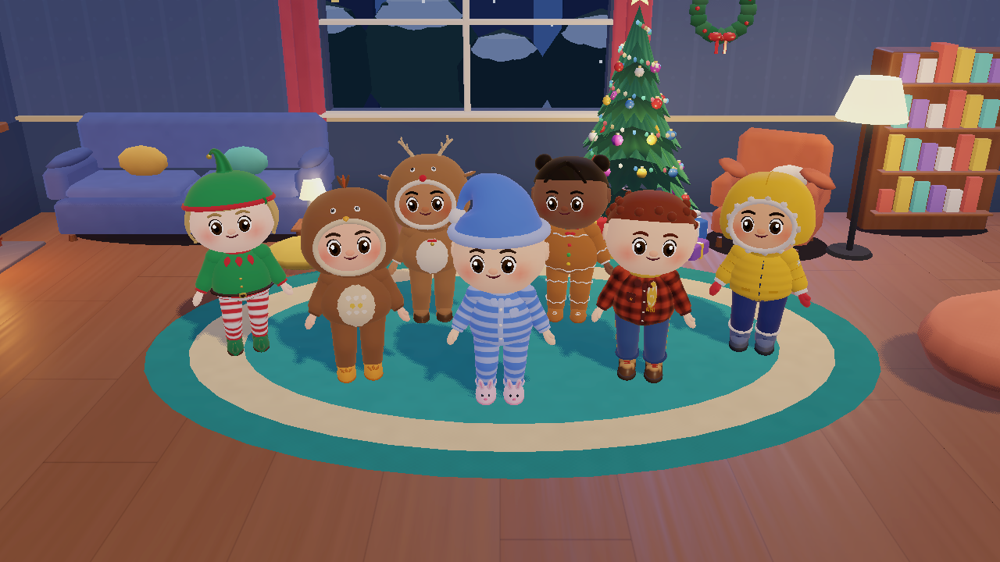
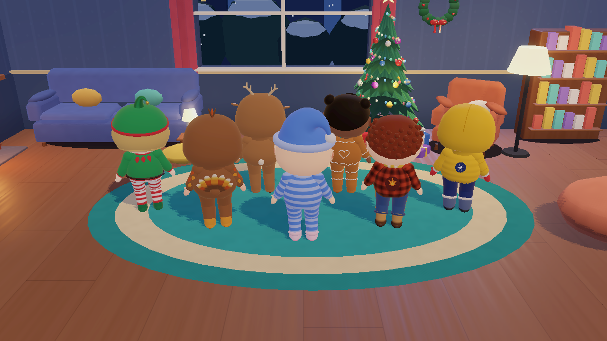

# Build 18 skins: six seasonal rotating Shop outfits

Two for Thanksgiving, three for Christmas, one for winter. All six are Coin
items (800-1,200 Coins) that join the Pass 8 rotating pool; none is an App
Store product or a Season reward. They are cosy, original designs: costume
onesies of animals and a biscuit, seasonal clothes, and a generic elf
helper. No cultural costumes, no stereotypes, no Santa likeness (no red suit,
white beard or Santa hat).

Pictures are Godot 4.7.2's Mobile renderer on Mesa llvmpipe under Xvfb (the
lobby framing, dorm light). They show shape, colour and fit, not device
performance.

| Front (lobby, dorm light) | Back |
|---|---|
|  |  |

Left to right: default pajamas (reference), Turkey Trot, Harvest Flannel,
Reindeer Onesie, Gingerbread Buddy, Elf Helper, Snow Day.

## What shipped

| Key (`outfit:<key>`) | Name | ID | Coins | Season | Joins the rotation | Part(s) | Triangles (LOD0) | Head |
|---|---|---|---|---|---|---|---|---|
| `turkey_trot` | Turkey Trot | 24 | 900 | Thanksgiving | 2026-11-25 | `turkey` | 10,984 | hood up (replaces hat and hair) |
| `harvest_flannel` | Harvest Flannel | 25 | 800 | Thanksgiving | 2026-11-21 | `flannel` | 11,080 | player's hat and hair |
| `reindeer_onesie` | Reindeer Onesie | 26 | 1,000 | Christmas | 2026-11-30 | `reindeer` | 11,218 | hood up (replaces hat and hair) |
| `gingerbread_buddy` | Gingerbread Buddy | 27 | 900 | Christmas | 2026-12-01 | `gingerbread` | 10,876 | player's hat and hair |
| `elf_helper` | Elf Helper | 28 | 1,100 | Christmas | 2026-11-30 | `elf` + `acc_elf_cap` | 11,012 + 3,372 | elf cap with no hat; else the chosen hat |
| `snow_day` | Snow Day | 29 | 1,200 | winter | 2026-12-01 | `snowday` | 11,324 | hood up (replaces hat and hair) |

Every outfit draws its own footwear in its part (`Cosmetics.OUTFIT_OWN_SHOES`,
"worn instead of your shoes with this outfit"). IDs 24-29 are new and never
reused. Source: `tools/character/outfits_b18.py` (`B18_PARTS`).

### Exactly what each one includes (`Cosmetics` `includes`, shown to buyers)

- **Turkey Trot:** cosy chestnut turkey onesie with a feathered cream breast
  and wing feathers on the sleeves; turkey hood with eyes, a little beak and
  a feather tuft (replaces hat and hair while worn); a tail fan of banded
  autumn feathers; orange footed booties.
- **Harvest Flannel:** red buffalo-check flannel shirt with a pointed
  collar, buttons and a pocket; a chunky mustard knit scarf with a fringed
  end; embroidered maple leaves on the pocket and the back; denim jeans with
  turned-up cuffs; laced duck boots.
- **Reindeer Onesie:** caramel reindeer onesie with a cream belly, cream
  cuffs and a fluffy tail; a red ribbon bow with a gold bell; reindeer hood
  with soft antlers, ears, eyes and a red pompom nose (replaces hat and hair
  while worn); footed hooves.
- **Gingerbread Buddy:** gingerbread-brown suit with piped white icing at the
  collar, hem, cuffs and ankles; three gumdrop buttons and a red bow; an
  icing heart on the back; iced gingerbread booties.
- **Elf Helper:** green tunic with a red petal collar, a belt with a gold
  buckle and a white hem; red-and-white striped stockings; curled green
  shoes with gold bells; a green elf cap with a red band, holly and a gold
  bell (outfit headwear, shown when no other hat is worn).
- **Snow Day:** quilted sunshine-yellow parka with a snowflake on the back
  and the sleeve; the hood worn up with a faux-fur rim (replaces hat and hair
  while worn); red knit mittens; puffy navy snow pants; fur-cuffed snow
  boots.

### Decisions

- **Rules as Pass 8.** Hoods are `HOOD_OUTFITS` with the Pass 8 face opening
  (`HOOD_OPEN`); the elf cap is `OUTFIT_HEADWEAR` (worn with no hat, hair
  rule `@cap` in `HEADWEAR_AS_HAT`); any chosen hat wins over it. Hoods,
  antlers, beak, nose, cap, bell and the turkey's fan are rigid on one bone;
  nothing is simulated or emissive; one shared material, no new material.
- **Seasonal start, no early offers.** Catalogue items carry
  `"rotation_from"` (00:00 UTC): `tools/make_offer_schedule.py` adds an item
  to the pool only from that change, so the Thanksgiving skins first appear
  on 11-21 / 11-25 and the December ones on 11-30 / 12-01. No offer that
  started before today (2026-11-17) changed: those keep their ids and
  revision 1. `offers.schedule_revision` is 2; the pool is 16 skins, so the
  rule's cycle is 8 days (each skin in the Shop 2 days, away 6). The
  generator now keeps an unchanged offer exactly as written (before, it
  re-stamped the new revision number on kept offers).
- **Visual fix in this pass:** the Snow Day hood's crown seam ran down over
  the fur rim onto the forehead; it now stops well above the rim (seen in
  close-ups, fixed in `outfits_b18.py`, GLB rebuilt).
- The hoods leave the same small strip of nape visible at the back as the
  shipped Cloud Nine, Bedtime Bandit and Night Owl hoods (compared in
  close-ups); that is the shared hood construction, not a gap.

## Budgets

- Each outfit part, with its footwear, is at most 11,500 triangles (Pass 8:
  10.1k-12.6k); the elf cap is under 4,500.
- The heaviest look with any build 18 outfit (every hat, shoe, hair and
  marks combination) is no heavier than the heaviest look before, and no
  build 18 look draws more than 7 parts (draw calls)
  (`test_outfits_b18::test_budgets_against_the_heaviest_look`).
- `CharacterArt.VERSION` changes with the GLB's hash, so cached portraits and
  thumbnails re-render.

## Checks run (final asset)

| Command | Summary line |
|---|---|
| `tools/character/build.sh` | `fit_check: 30 looks, 567 poses, 56 head looks (hat x hair), 0 failures` |
| `tools/.cache/bpyenv/bin/python tools/character/outfit_check.py` (exit 0) | `complete skins (skins_check.py): 0 failures` / `failures: 0` |
| `tools/.cache/bpyenv/bin/python tools/character/clip_check.py` (exit 0) | `clips with the arms > 1 cm inside the head or the goggles: 0` |
| `tools/run_tests.sh outfits` | `22 tests, 1306 checks, 0 failures` |
| `tools/run_tests.sh skins` | `10 tests, 201 checks, 0 failures` |
| `tools/run_tests.sh catalogue` | `17 tests, 3273 checks, 0 failures` |
| `tools/run_tests.sh shop` | `28 tests, 2024 checks, 0 failures` |
| `tools/run_tests.sh fit` | `44 tests, 7880 checks, 0 failures` |
| `tools/run_tests.sh characters` | `5 tests, 40 checks, 0 failures` |
| `tools/run_tests.sh profile` | `12 tests, 117 checks, 0 failures` |
| `tools/run_tests.sh test_outfits_b18` | `6 tests, 492 checks, 0 failures` |
| `tools/run_tests.sh offers` | `1 tests, 2 checks, 0 failures` |
| `cd service && npm test` | `# tests 96` / `# pass 96` / `# fail 0` |
| `python3 tools/make_offer_schedule.py --check` | `offer schedule up to date (366 offers)` |
| `node service/tools/sync_catalogue.mjs --check` | `catalogue copy up to date` |

The outfit_check maxima for the hoods (arms meeting the hood in the
hands-to-head clips) are within the shipped hoods' baseline plus the
allowed margin: Turkey Trot and Reindeer Onesie 5.8 / 7.5 cm (features /
shell, the same as Night Owl and Duck), Snow Day 5.4 / 7.7 cm (margin
1.0 / 0.5 cm). The turkey's fan never enters a limb (0.0 cm) and stays
above the ground outside the splash clips. The other three outfits: 0.0 cm.

Renders: `character_lineup.tscn -- --lineup=b18` and `--lineup=b18back`,
`--light=dorm` (the default Mobile renderer; under `--rendering-driver
opengl3` llvmpipe runs out of shader instance uniforms in this scene and
draws some parts in default colours, for every outfit, old or new).
Close-ups: `--lineup=custom --shots-file=...` (front, back, side and head
shots of each outfit).
